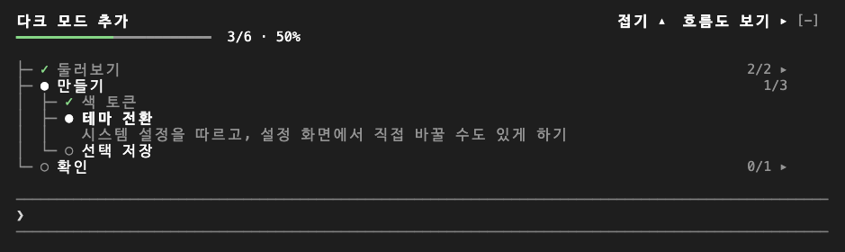
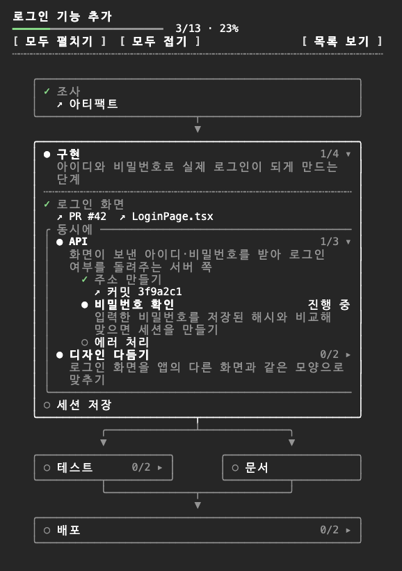

# Plan Flow

[English](README.md) | **한국어**

Claude가 하고 있는 일의 계획을 Claude Code 안에 그려 주는 [Claude Code](https://claude.com/claude-code) 모드예요. 모드가 따로 쓰는 작은 모델이 옆에서 세션을 지켜보며 일을 단계, 작업, 확인 지점으로 나눠 두면, 작업하는 동안에는 입력창 위에 트리로, 전체를 보고 싶을 때는 옆 서랍에 흐름도로 진행이 보여요.



## 빠른 시작

Claude Code 세션의 입력창에서:

```text
/plugin marketplace add https://github.com/SummerRiversound/plan-flow.git
/plugin install plan-flow@plan-flow
```

그다음 두세 단계가 넘는 일을 Claude에게 맡기면 몇 초 안에 입력창 위에 계획이 나타나고, 일이 진행되는 대로 따라가요. 흐름도는 `/flow`로 열어요.

## 화면에 보이는 것

- **입력창 위 트리.** 계획 제목, 이 작업이 무엇을 위한 것인지 흐린 한 줄, 진행 막대, 그 아래 단계와 작업이 보여요. 진행 중인 단계는 굵게, 무엇을 왜 하는지 한 문장과 함께 나와요. Claude가 질문하거나 권한을 묻거나, 일이 남은 채 턴을 끝내 사용자 답을 기다리면(백그라운드 에이전트·workflow·셸이 아직 돌고 있으면 그 대신 `백그라운드 작업 N개 진행 중`이 흰 글씨로 나와요) 진행 막대 아래에 파란 보라색 `● 답변 기다리는 중`이 나오고, 진행 중 단계도 같은 색으로 바뀌어요. 끝난 단계는 한 줄로 접히고, 트리는 지금 단계 주변 10줄까지만 써서 대화를 밀어내지 않아요. 제목(`▴`)을 누르면 제목과 그 한 줄, 진행 막대만 남고, 다시(`▾`) 누르면 펼쳐져요. 오른쪽의 `흐름도 보기 ▸`는 서랍을 열어요. 계획이 끝나면 제목과 그 한 줄, 100% 진행 막대만 남게 접혀서 다음 계획이 시작될 때까지 남아 있고, 제목을 누르면 펼쳐져요.
- **서랍의 흐름도.** `/flow`를 입력하면 대화 옆에 열려요. 단계마다 상자 하나이고, 동시에 진행되는 단계는 나란히 놓였다가 아래에서 다시 합쳐져요. 상자는 한 단계씩 펼쳐지고, 스크롤하기 전까지는 진행 중인 단계를 따라가요. 서랍이 좁거나 `목록 보기`를 누르면 같은 계획이 들여쓴 목록으로 보여요. 데스크톱 앱과 에디터에서는 트리와 서랍을 앱 글꼴로 그려요. 단계마다 둥근 카드가 선으로 이어지고, 진행 막대는 실제 막대로 보이며, 서랍은 앱이 직접 스크롤하고, 진행 중인 단계에 초점이 가요.
- **단계별 결과물 링크.** 단계마다 그 단계에서 나온 PR, 이슈, 커밋, 아티팩트, 파일을 붙일 수 있어요. 서랍에 짧은 이름으로 보이고, 누르면 열려요.
- **직접 확인해야 하는 단계.** 폰에서 눌러 보기, 로그인, 판단이 필요한 일처럼 사용자만 할 수 있는 단계는 진행률을 붙잡지 않고 확인을 기다려요. 이런 단계는 진행 막대 아래 한 줄에 모여요. 서랍에서 단계를 누르면 `확인 완료`로 표시하거나, `논의`를 눌러 그 단계에 대한 메시지를 입력창에 초안으로 채울 수 있어요.
- **완료 정리.** 모든 단계가 끝나면 서랍 맨 아래에 이 계획이 무엇을 위한 것이었고 어떻게 이뤘는지가 정리돼요.



## 계획이 세션을 따라가는 방식

계획판은 메시지 하나가 아니라 세션 전체의 작업을 따라가요.

- 같은 일을 이어서 하면 지금 계획의, 그 일이 이어지는 단계 아래에 더해져요. 새 단계는 일의 새 부분일 때만 생겨요.
- 중간에 다른 일을 잠깐 하면(예를 들어 급한 버그 수정) 지금 계획은 보관했다가, 그 일이 끝나면 다시 돌아와요. 보관한 계획은 서랍 맨 아래에 있고, 누르면 그 안의 단계를 볼 수 있어요.
- 처음부터 다시 하면 지금 계획은 취소돼요.
- 다시 해야 하는 단계는 다시 열리고, 끝날 때까지 `↺` 표시가 붙어요.
- Claude가 묻지 않고 이어서 할 일은 요청에서 따라 나온 리뷰·머지·릴리스까지 일반 단계로 그려요. 계획 뒤에 사용자의 결정이나 다른 사람을 기다리는 일(예를 들어 사용자가 정할 머지, 아직 오지 않은 리뷰 반영)은 두 개까지 마지막 단계 뒤에 흐린 점선으로 붙어요. 진행률에는 들어가지 않고, 실제로 시작되면 일반 단계가 되며, 계획이 끝나도 남아요.
- 끝난 계획 뒤에 새 일을 맡기면 새 계획이 생기고, 끝난 계획은 보관함에 남아요.

이 중 무엇에 해당하는지는 모드의 계획 담당 모델이 사용자 메시지, Claude가 부른 도구, Claude가 한 말을 보고 정해요. 계획이 시작되거나 목표가 바뀌면, 대화의 복사본으로 Claude에게 한 번 설계를 물어요. 목표는 사용자가 끝에 얻으려는 결과로, 단계는 거기까지 가는 전체 길로 잡아요. 작업 중인 대화는 계획판을 보지 않아요. Claude가 읽는 내용에 아무것도 더하지 않으니, 이 모드 때문에 Claude의 작업 방식이 바뀌지 않아요.

## 설정

설치 화면에서 정하고, 나중에는 `/config`에서 바꿀 수 있어요.

| 설정 | 기본값 | 하는 일 |
| --- | --- | --- |
| `language` | `auto` | 트리, 서랍, 알림의 언어예요. `en` 또는 `ko`를 고르고, `auto`는 Claude Code의 언어 설정, 그다음 시스템 로캘, 그다음 영어를 따라요. |
| `autoShow` | 켬 | 계획이 시작되자마자 트리를 보여 줘요. 끄면 `/flow`를 입력한 뒤에만 보여요. |

## 작업 없이 둘러보기

`/flow demo`로 예시 계획판을 차례로 볼 수 있어요. 동시에 진행되는 갈래, 긴 계획, 추가되거나 다시 열린 단계, 보관 후 복귀, 막히거나 건너뛴 단계, 다 끝난 계획이 들어 있어요. `/flow demo next`로 다음, `/flow demo stop`으로 끝내요. 내 계획판은 그대로예요.

## 읽고 남기는 것

이 모드는 파일을 쓰지 않고 Claude Code의 훅으로만 동작해요. 도구를 더하지 않고, Claude가 읽는 내용에도 아무것도 더하지 않아요.

- **남기는 것**: 최근 세션 20개의 계획판을 Claude Code가 이 모드에 준 저장 공간에 둬요. 다시 이어 연 세션이 자기 계획을 찾을 수 있게 하려는 거예요. 계획판에는 Claude가 쓴 단계 이름, 설명, 메모, 링크가 들어 있어요. 그 옆에 세션마다 이 모드가 부른 모델 호출 최근 50건(시각, 어떤 호출인지, 걸린 시간, 결과)을 남겨서, 계획판이 멈췄을 때 이유를 알 수 있게 해요.
- **작은 모델(Haiku)에게 계획판 관리를 맡겨요**: 메시지를 보낼 때, 무언가를 바꾸는 호출이 6번 쌓일 때마다, Claude가 읽기만 하는 동안에는 1분에 한 번, Claude가 호출 사이에 무언가 말할 때, Claude가 답할 때요. Claude가 일하는 동안에는 최소 20초 간격을 둬요. 호출이 실패하면 15초 뒤에 한 번 더 해요. 계획판, 사용자 메시지, 도구 호출마다 한 줄(서브에이전트의 호출 포함. 호출이 밝힌 목적이나 건드리는 파일 이름, 검색어를 보내고 실패했으면 표시해요. 파일 내용이나 명령 출력은 보내지 않아요), Claude가 받은 알림마다 한 줄(백그라운드 작업 완료 등), Claude가 호출 사이에 한 말과 Claude 답의 앞부분을 보내요. Claude Code의 모델 접근을 그대로 쓰고 세션 비용 합계에는 들어가지 않으며, 한 번에 수천 토큰 정도로 대부분 캐시돼요.
- **대화 복사본에게 계획 설계를 물어요**: 계획 담당 모델이 계획을 시작하거나 목표를 바꿨을 때만, 메시지 하나에 최대 한 번, Claude가 그 메시지를 받은 뒤에 물어요. 복사본은 세션의 대화 그대로에 계획판과 질문 하나를 붙인 것이고, 도구 없이 답해요. 그 답은 계획판을 고치는 데만 쓰이고 다른 곳으로 가지 않아요. 작은 모델의 호출과 따로 돌아서 그쪽을 막지 않고, 2분이 지나면 더 기다리지 않으며, 그사이 다른 계획으로 바뀌었으면 답을 적용하지 않아요. 대화는 세션의 캐시에서 읽으니, 한 번에 Claude의 요청 한 번 정도의 비용이 들어요.
- **도구 호출을 보는 이유**: Claude가 지금 무엇을 하는지(예: `Edit 실행 중`) 보여 주고, 위의 줄을 만들기 위해서예요. 호출을 바꾸거나 막지 않아요.
- **읽는 설정**: `language`가 `auto`일 때만 Claude Code의 `language` 설정과 `LC_ALL`, `LC_MESSAGES`, `LANG` 환경 변수를 읽어요.
- **새 버전 확인**: 설치본이 들어 있는 폴더를 살펴보고, 하루에 한 번 raw.githubusercontent.com에서 이 레포의 `.claude-plugin/plugin.json`을 읽어요. 더 새 버전이 설치돼 있거나 나와 있으면 계획 띠 제목 줄에 알려 줘요. `CLAUDE_CODE_DISABLE_NONESSENTIAL_TRAFFIC`를 설정하면 네트워크로 읽지 않아요.
- **입력창 채우기**: 단계에서 `논의`를 눌렀을 때만 입력창에 초안을 넣어요. 보내기 전까지는 아무것도 전송되지 않아요.

## 요구 사항

모드(함수 훅 플러그인)를 지원하는 Claude Code 2.1.318 이상이 필요해요. 모드는 아직 얼리 액세스라 버전마다 API가 바뀔 수 있어요. 트리와 서랍은 터미널 기준으로 그리고, 데스크톱 앱과 에디터 확장에서도 같은 화면이 보여요.

## 업데이트와 제거

```sh
claude plugin marketplace update plan-flow
claude plugin update plan-flow@plan-flow
claude plugin uninstall plan-flow@plan-flow
```

업데이트는 재시작 뒤에 적용돼요. 버전별 변경은 [변경 이력](CHANGELOG.md)에 있어요.

## 개발

```sh
claude plugin validate .
claude plugin test .
claude --plugin-dir .
```

`tsconfig.json`은 Claude Code가 이 폴더의 모드를 처음 불러올 때 만드는 `.claude-plugin/types/tsconfig.json`을 이어받아요. 그래서 `tsc -p .`로 타입 검사를 하기 전에 `claude --plugin-dir .`를 한 번 실행해 두세요. 화면 규칙은 [DESIGN.md](DESIGN.md), 릴리즈 절차는 [RELEASING.md](RELEASING.md)에 있어요.

실제 세션에서 계획판이 얼마나 쓸모 있었는지 보려면 `bun scripts/review.ts`로 계획판이 저장된 세션 목록을 보고, `bun scripts/review.ts <세션>`으로 사람이 마지막으로 본 판을 Opus가 채점하게 하세요. 기준은 사용자가 판을 쓰며 세운 기준과 `.claude/CLAUDE.md`의 결정 목록이에요. `--replay`를 붙이면 세션 기록(하위 에이전트의 호출 포함)으로 계획판 모델을 다시 돌려 그 판도 채점해요. 계획판 지시문을 바꿨을 때 같은 세션이 어떻게 달라지는지 볼 때 써요. 결과 페이지에는 그 세션에 남은 모델 호출 기록도 나와요. 결과 페이지와 점수는 `.scratch/review/`에 남고, 모델은 내 로그인으로 `claude -p`를 거쳐 불러요. `bun scripts/review-all.ts`는 저장된 세션을 5개씩 한꺼번에 채점해 점수표 `.scratch/review/index.html`을 만들어요. `--limit N`은 최근 N개만, `--replay`는 그대로 넘겨요.

## 후원

Plan Flow가 도움이 됐다면 [커피 한 잔](https://ko-fi.com/riversound)으로 응원해 주세요. 고맙습니다!

## 라이선스

[MIT](LICENSE)
