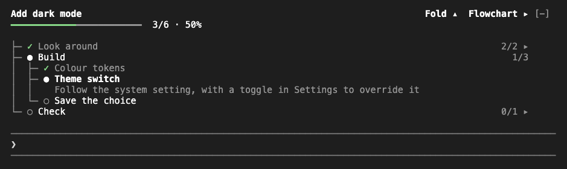
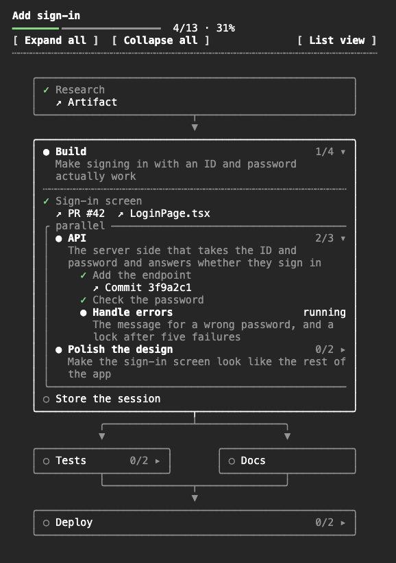

# Plan Flow

**English** | [한국어](README.ko.md)

A [Claude Code](https://claude.com/claude-code) mod that shows the plan Claude is working through, right inside Claude Code. Claude lays the work out as stages, tasks and checkpoints, and you watch it move: a live tree above the prompt while it works, and a flowchart in a side drawer when you want the whole picture.



## Quick start

At the prompt of a Claude Code session:

```text
/plugin marketplace add https://github.com/SummerRiversound/plan-flow.git
/plugin install plan-flow@plan-flow
```

Then ask Claude for any task that takes more than a couple of steps. It sets up a plan on its own, and the tree appears above the prompt. Type `/flow` to open the flowchart.

## What you see

- **The tree above the prompt.** The plan's title, one dim line on what the work is for, and a progress bar, then the stages with their tasks. The running step is bold and shows one sentence on what it does and why. Finished stages fold to one line, and the tree keeps to 10 rows around the current step, so it never pushes your conversation away. Press the title (`▴`) to shrink it to the title, that line and the progress bar, and again (`▾`) to open it. `Flowchart ▸` on the right opens the drawer. When the plan is done, the tree goes away after 5 seconds.
- **The flowchart in the drawer.** `/flow` opens it beside the conversation. Each stage is a box; steps that run at the same time sit side by side and join again below. Boxes unfold one level at a time, and the drawer follows the running step until you scroll. In a narrow drawer, or with `List view`, the same plan shows as an indented list. On the desktop app and in the editor, the tree and the drawer are set in the app's own type: each stage is a rounded card joined by lines, the progress bar is a real bar, the drawer scrolls by itself, and the step Claude is on takes the focus.
- **Links to what each step produced.** A step can carry its pull request, issue, commit, artifact or file, shown in the drawer as short names that open on click.
- **Steps only you can confirm.** Some steps need you: trying something on a phone, signing in, a judgement call. They wait for your check without holding the progress back, and they are listed together under the progress bar. Press one in the drawer to mark it `Checked`, or press `Discuss` to start a message about it in the prompt box.
- **A closing note.** When every step is done, the drawer ends with what the plan was for and how that was reached.



## How the plan follows your session

The board follows the work of the whole session, not each message:

- More work on the same task joins the current plan as new steps.
- A detour (say, a quick bug fix in the middle) puts the current plan on a shelf, and it comes back when the detour is done.
- Starting over cancels the current plan.
- A step that has to be redone opens again and is marked `↺`.

Claude decides which of these fits each request. When a change you make on the board (a step you checked) matters, Claude hears about it with your next message.

## Options

Set them on the install screen, or later in `/config`.

| Option | Default | What it does |
| --- | --- | --- |
| `language` | `auto` | The language of the tree, the drawer and the notices: `en` or `ko`. `auto` follows Claude Code's own language setting, then the system locale, then English. |
| `autoShow` | on | Shows the tree as soon as a plan starts. Off, it shows only after you type `/flow`. |
| `enforce` | off | Refuses edits, shell commands and subagents until the task has a plan. After three refusals in one turn, it lets the turn go on without one. |

## Try it without a task

`/flow demo` walks through sample boards: a plan with parallel branches, a long plan, added and reopened steps, a detour, blocked and skipped steps, a finished plan. `/flow demo next` moves on and `/flow demo stop` ends it. Your own board is not touched.

## What it reads and keeps

The mod writes no files, and its one network call is the version check below. It adds one tool Claude calls, `plan`, and works only through Claude Code's own hooks.

- **Keeps** the board of your 20 most recent sessions in Claude Code's storage for this mod, so a session that resumes finds its plan again. A board holds the step titles, details, notes and links Claude wrote.
- **Adds to what Claude reads**: a short instruction on using the board, and a note on each of your messages saying where the plan stands, or that there is none yet. When Claude first changes something in a turn with no plan, one line after that tool's result reminds it to set one. When one step has gone through 8 changes with the plan unchanged, one line asks Claude, once for that step, to split it if it holds parts you would check one by one.
- **Watches tool calls** to show what Claude is doing (for example `Running Edit`) and for those lines. With `enforce` on, it refuses the tools listed above until there is a plan.
- **Reads** Claude Code's `language` setting and the `LC_ALL`, `LC_MESSAGES` and `LANG` environment variables, only when `language` is `auto`.
- **Checks for a newer version**: it lists the folder its installed copy sits in, and once a day reads `.claude-plugin/plugin.json` from this repository on raw.githubusercontent.com. When a newer copy is installed or released, the band's title line says so. Setting `CLAUDE_CODE_DISABLE_NONESSENTIAL_TRAFFIC` skips the network read.
- **Fills your prompt box** only when you press `Discuss` on a step; nothing is sent until you send it.

## Requirements

Claude Code 2.1.318 or later, with mods (function-hook plugins). Mods are in early access, and their API may change between releases. The tree and the drawer are drawn for the terminal; the desktop app and the editor extensions get the same views.

## Update and uninstall

```sh
claude plugin marketplace update plan-flow
claude plugin update plan-flow@plan-flow
claude plugin uninstall plan-flow@plan-flow
```

An update applies after a restart. See the [changelog](CHANGELOG.md) for what each version changed.

## Development

```sh
claude plugin validate .
claude plugin test .
claude --plugin-dir .
```

`tsconfig.json` extends `.claude-plugin/types/tsconfig.json`, which Claude Code writes the first time it loads the mod from this folder, so run `claude --plugin-dir .` once before type-checking with `tsc -p .`. The look is described in [DESIGN.md](DESIGN.md), and releases follow [RELEASING.md](RELEASING.md).

## Support

If Plan Flow helps you, you can [buy me a coffee](https://ko-fi.com/riversound). Thank you!

## License

[MIT](LICENSE)
